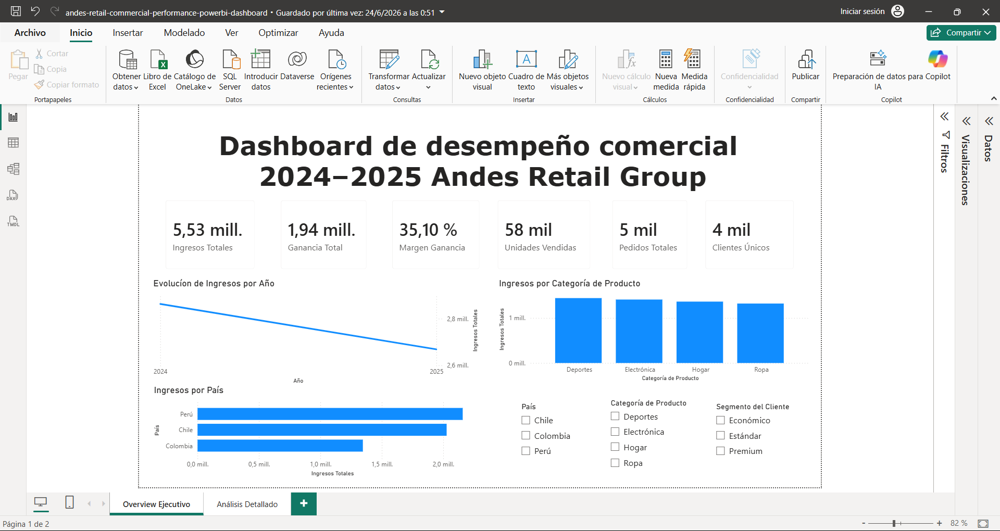
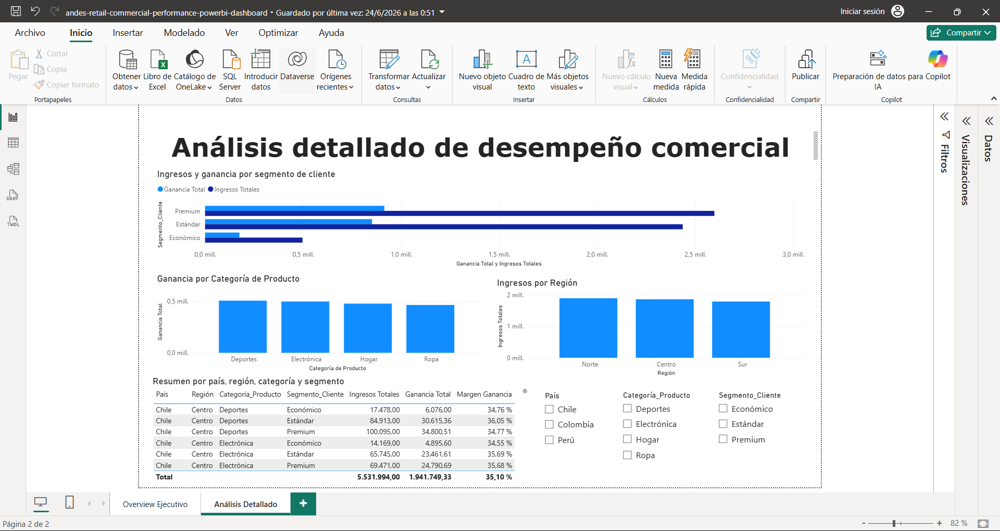

# Andes Retail Commercial Performance Analysis

Power BI dashboard project focused on commercial performance, revenue behavior, profitability, customer segments, product categories, geographic performance, and executive business interpretation for Andes Retail Group during 2024-2025.

This project is part of my professional data analytics portfolio and is positioned as a Business Intelligence / Marketing Data Analytics case study.

## Project Overview

This project analyzes the commercial performance of Andes Retail Group using a transactional Excel dataset and a Power BI dashboard.

The goal was to transform raw commercial data into an executive dashboard that helps monitor revenue, profit, margin, units sold, orders, customers, product categories, countries, regions, and customer segments.

The final dashboard includes two main views:

1. **Executive Overview**
2. **Detailed Analysis**

The project follows a complete business intelligence workflow:

```text
Excel dataset -> Power Query -> Power BI -> KPI modeling -> dashboard design -> business insights -> recommendations
```

## Business Context

Andes Retail Group operates across Colombia, Chile, and Peru, selling products across four main categories:

- Electronics
- Clothing
- Sports
- Home

The business needed a clear way to evaluate commercial performance during 2024 and 2025, identify where revenue and profit were concentrated, and detect opportunities by customer segment, product category, country, and region.

## Business Questions

This analysis addresses the following questions:

- How did total revenue evolve between 2024 and 2025?
- Which countries and regions generated the most revenue?
- Which product categories contributed most to profit?
- Which customer segments generated the highest commercial value?
- Where could Andes Retail Group focus future commercial actions?

## Dataset Used

The analysis uses a transactional Excel dataset containing commercial order data for 2024 and 2025.

Main fields include:

- Order ID
- Order date
- Season
- Customer ID
- Customer segment
- Region
- Country
- Product category
- Units sold
- Unit price
- Revenue
- Cost

The dataset was prepared in Power Query before building the dashboard in Power BI.

## Analytical Workflow

This project follows an **Excel → Power Query → Power BI → business insights** workflow.

### 1. Data exploration and preparation

- Imported the 2024–2025 transactional Excel dataset into Power BI Desktop.
- Reviewed the commercial fields and adjusted data types in Power Query: order date as date, units sold as whole number, unit price/revenue/cost as decimal numbers, and geographic/customer/product attributes as text.
- Created a conditional field, `Nivel_Venta`, to classify orders as **Venta Alta** for revenue greater than or equal to 1,000 and **Venta Baja** otherwise.
- Reviewed data consistency before using the fields in business indicators and visualizations.

### 2. Commercial KPIs

- Built and interpreted the reported indicators: total revenue, total profit, profit margin, units sold, total orders, and unique customers.
- Compared revenue and profitability by year, country, region, product category, and customer segment.

### 3. Power BI reporting

- Designed **Executive Overview** for rapid interpretation through KPI cards, annual revenue, category and country comparisons, and interactive filters.
- Designed **Detailed Analysis** to explore revenue and profit by customer segment, profit by product category, revenue by region, and combinations in the summary table.

### 4. Executive communication

- Applied the **SCQA** framework (Situation, Complication, Question, Answer) to the overview and detailed narratives.
- Turned descriptive business patterns into commercial recommendations and a concise executive update.

## Validated Commercial Results

The metrics below were independently recalculated from the **5,000 source records** in the Excel dataset committed to this repository, covering **January–December in both 2024 and 2025**. Values are expressed in the dataset's original units; the dataset does not identify a specific currency.

| Metric | Verified result |
|---|---:|
| Revenue (2024–2025) | 5,531,994.00 |
| Source cost (2024–2025) | 3,590,244.67 |
| Profit (revenue minus source cost) | 1,941,749.33 |
| Profit margin | 35.10% |
| Units sold | 57,601 |
| Orders | 5,000 |
| Unique customers | 3,821 |

### Year-over-year performance

| Metric | 2024 | 2025 | Change |
|---|---:|---:|---:|
| Revenue | 2,863,384 | 2,668,610 | **−6.80%** |
| Profit | 1,005,811.62 | 935,937.71 | **−6.95%** |
| Profit margin | 35.13% | 35.07% | **−0.06 pp** |
| Orders | 2,550 | 2,450 | **−3.92%** |

These are **full-year comparisons**, not incomplete-year or YTD figures. The dashboard's rounded KPI cards (5.53M revenue, 1.94M profit, 35.10% margin, 58K units, 5K orders, 4K customers) are consistent with the source at their displayed precision. The small margin difference is expressed in percentage points (pp), not percent.

## Key Metrics

The dashboard tracks the following key performance indicators:

| Metric | Result |
|---|---:|
| Total Revenue | 5.53M |
| Total Profit | 1.94M |
| Profit Margin | 35.10% |
| Units Sold | 58K |
| Total Orders | 5K |
| Unique Customers | 4K |

These metrics provide an executive view of the business performance and support deeper analysis by segment, category, country, and region.

## Power BI Dashboard

### Executive Overview

The executive view summarizes the main business indicators: total revenue, total profit, profit margin, units sold, total orders, and unique customers. It also shows annual revenue evolution, revenue by product category, revenue by country, and interactive filters for country, category, and customer segment.

<p align="center">
  
</p>

### Detailed Analysis

The detailed view explores revenue and profit by customer segment, profit by product category, revenue by region, and a summary table by country, region, product category, and customer segment. This page supports deeper commercial diagnosis and opportunity detection.

<p align="center">
  
</p>

## Key Findings

Some of the main findings from the dashboard include:

1. **Revenue declined 6.80% from 2024 to 2025, while margin remained close to 35%.**  
   Full-year revenue decreased from 2,863,384 to 2,668,610 (−194,774), while profit decreased 6.95%. The profit margin changed from 35.13% to 35.07% (−0.06 percentage points). The data shows **lower sales volume/value with broadly stable profitability per unit of revenue**, but does not establish what caused the decline.

2. **Premium led total revenue and profit, but this is a contribution measure—not proof of higher customer lifetime value.**  
   Premium produced 2,598,217 in revenue and 914,605.16 in profit, ahead of the Standard segment (2,436,769 and 851,758.99). Further customer-level analysis would be required to establish lifetime value or retention.

3. **The Economic segment had a lower contribution.**  
   This segment may require a differentiated commercial strategy depending on the company's goals for acquisition, retention, or profitability.

4. **Sports and Electronics led by absolute profit contribution.**  
   Sports generated 505,253.12 in profit (35.07% margin), and Electronics generated 496,738.15 (35.26% margin). These differences should not be confused with a large category-level margin advantage.

5. **Regional revenue was relatively balanced, with North slightly ahead.**  
   North generated 1,890,166, Center 1,857,015, and South 1,784,813 in revenue across the two years. These are descriptive differences; the dashboard does not establish regional causes.

6. **The detailed summary table supports more specific opportunity detection.**  
   Combining country, region, product category, and customer segment helps identify more precise commercial patterns.

## Business Recommendations

Based on the analysis, Andes Retail Group could consider the following actions:

1. **Investigate the verified 6.80% annual revenue decline.**  
   Break down the change in orders, units, average order value, country, category, and segment. Demand, seasonality, product mix, pricing, and campaigns are **hypotheses to investigate**, not proven explanations.

2. **Prioritize commercial actions for the Premium segment.**  
   Since Premium customers generate the highest revenue and profit, this segment should be considered for retention, loyalty, and upselling strategies.

3. **Strengthen high-performing categories such as Sports and Electronics.**  
   These categories can be used as strategic levers for campaigns, inventory planning, and commercial focus.

4. **Use regional monitoring to adjust sales and marketing efforts.**  
   Regional differences can help guide localized campaigns and commercial resource allocation.

5. **Review the Economic segment separately.**  
   Its lower contribution does not necessarily mean it should be ignored, but it may require different pricing, messaging, or product strategies.

## Tools and Skills

- **Microsoft Excel:** source transactional data and commercial field interpretation.
- **Power Query:** importing data, defining appropriate data types, reviewing consistency, and creating the `Nivel_Venta` conditional classification.
- **Power BI Desktop:** commercial KPIs, report layout, comparative charts, table summaries, slicers, and interactive executive reporting.
- **Commercial and Marketing Analytics:** interpreting revenue, profit, margin, sales volume, customer segments, product-category performance, and geographic differences.
- **Business Storytelling (SCQA):** framing business questions, explaining commercial findings, and translating them into recommendations.

## Professional Value

This project demonstrates my ability to transform commercial data into a clear and usable executive report. The combination of Power Query preparation, business KPIs, interactive Power BI views, and actionable interpretation is relevant to **Data Analyst, Marketing Data Analyst, Commercial Analyst, and Business Intelligence Analyst** roles.

## Personal Voice and Learning

My background in marketing shaped the way I approached this case: I did not want to show sales figures without connecting them to commercial decisions. The executive view answers *what happened*; the detailed view helps explore *where* revenue and profit are concentrated.

One important lesson was to separate **a visible pattern from its underlying cause**. The dashboard indicates lower revenue in 2025 than in 2024, but that alone cannot establish whether demand, pricing, product mix, seasonality, or marketing execution caused the change. Those remain hypotheses to test before committing resources.

This work strengthened my ability to combine **data preparation, KPI interpretation, visual communication, and commercial reasoning** in a format a stakeholder can understand quickly.

## Repository Structure

```text
andes-retail-commercial-performance-analysis/
├── dashboard/
│   └── andes-retail-commercial-performance-powerbi-dashboard.pbix
├── datasets/
│   └── andes-retail-group-2024-2025-dataset.xlsx
├── images/
│   ├── 1_overview-ejecutivo.png
│   └── 2_analisis-detallado.png
├── andes-retail-commercial-performance-project-notebook.ipynb
└── README.md
```

## File Guide

- `dashboard/andes-retail-commercial-performance-powerbi-dashboard.pbix`  
  Power BI dashboard file with the Executive Overview and Detailed Analysis pages.

- `datasets/andes-retail-group-2024-2025-dataset.xlsx`  
  Source Excel dataset used for the commercial performance analysis.

- `images/1_overview-ejecutivo.png`  
  Screenshot of the Executive Overview page displayed directly in this README.

- `images/2_analisis-detallado.png`  
  Screenshot of the Detailed Analysis page displayed directly in this README.

- `andes-retail-commercial-performance-project-notebook.ipynb`  
  Project notebook documenting the dashboard development, SCQA narrative, evaluator feedback, and business interpretation. It is a Markdown-oriented academic document, not a Python analysis pipeline.

- `README.md`  
  Portfolio documentation with business context, workflow, findings, recommendations, and dashboard previews.

## Reproducibility Note

The source Excel dataset and the Power BI `.pbix` are included in this repository. Download them and open the report in **Power BI Desktop** to explore the interactive dashboard. If the original Excel source path is unavailable on another computer, update it in **Power Query / Data source settings** before refreshing.

The `.ipynb` documents the original project and its SCQA storytelling. It is primarily a narrative notebook, **not an executable Python pipeline**. The two PNGs embedded above are static dashboard previews for recruiters and do not replace the interactive `.pbix`.

Results are reported in the original dataset's units; no specific currency is asserted unless confirmed by the source.

## Project Status

The original dashboard was completed and reviewed during the academic project. On `portfolio-polish`, the source Excel figures, annual comparison, and principal commercial findings have been cross-checked for portfolio documentation. The published Power BI report remains the original project; the `main` branch will only be updated after final approval.
